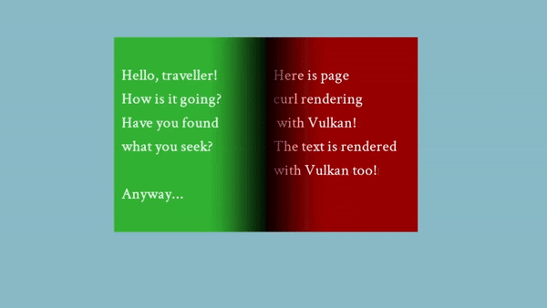
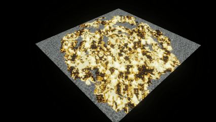
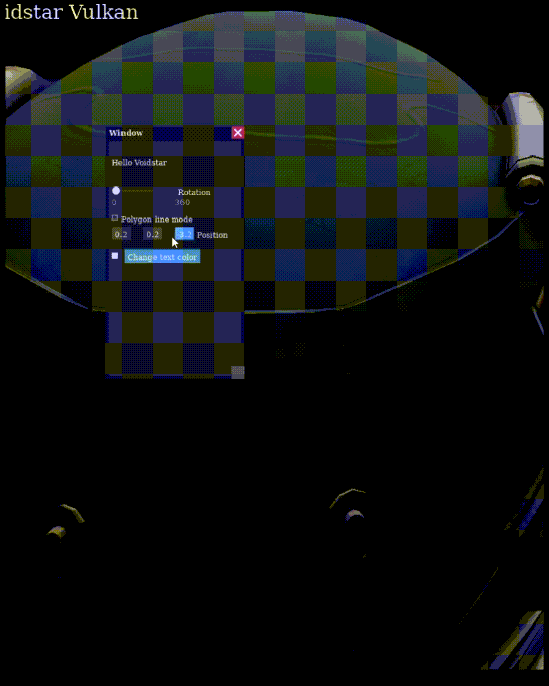

# Voidstar
A [project](https://www.youtube.com/playlist?list=PLF_V0mPHXtuJKMe45rwgXtpii-B2kfCOH)-driven Vulkan Renderer

### Description

The game thread builds the frame and a separate render thread executes it

| Virtual texture (65536x32768) | Page rendering |
| ---- | ---- |
|  |  |

---
### Divinity: OS surface

  

### UI Rendering

  
  &nbsp;
  

---

| cloud rendering | cloud rendering |
| ---- | ---- |
|  |  |

---

| quadtree rendering | quadtree rendering |
| ---- | ---- |
|  |  |

